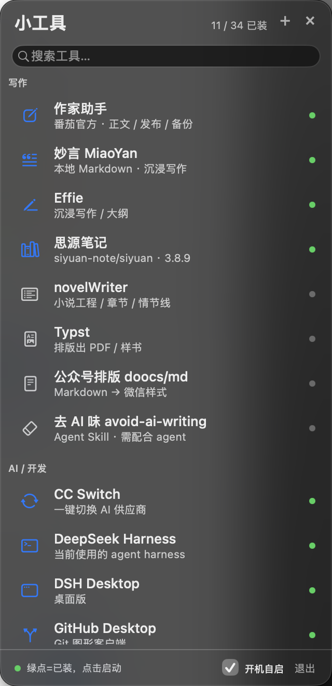

# ToolSidebar

> A floating macOS sidebar for your writing, AI and system utilities — with a local agent that searches GitHub, downloads, verifies and installs tools for you.

[中文说明](README.md) · [Download](https://github.com/LOVERS0/tool-sidebar/releases) · [Website](https://lovers0.github.io/tool-sidebar/)



## What it does

- One column for all your small tools (26 built in, grouped + fuzzy search), green dot = installed, click to launch.
- Keyboard-first: `↑↓` select, `⏎` open/install, `Esc` clear/close, `⌘F` search, `⌥⌘T` toggle sidebar.
- **Local install agent**: find latest GitHub Release → pick macOS asset → download → verify SHA-256/signature/Gatekeeper → install to `~/Applications` → add to catalog. No browser windows.
- Batch install, update checks, uninstall, migration export/import, custom categories/rename/order.
- Collapse into a draggable floating ball; optional silent launch at login.
- Sparkle appcast auto-update + native fallback.
- Optional CN↔EN dictionary translator (offline by default; online opt-in). For serious translation use Easydict/Pot from the curated list.

## Requirements

- macOS 13 or later (universal: Apple Silicon + Intel).
- The app is ad-hoc signed, **not notarized**. On first launch, right-click the app → **Open**, or run:
  `xattr -dr com.apple.quarantine /Applications/ToolSidebar.app`

## Install

### Download
1. Download `ToolSidebar.zip` from [Releases](https://github.com/LOVERS0/tool-sidebar/releases/latest).
2. Unzip and move `ToolSidebar.app` to `/Applications`.
3. Right-click → Open (first launch only).

### Homebrew
```bash
brew tap lovers0/tool-sidebar
brew install --cask tool-sidebar
```
If Gatekeeper blocks it, add `--no-quarantine`.

## Build from source

```bash
git clone https://github.com/LOVERS0/tool-sidebar
cd tool-sidebar
./build.sh        # requires Xcode Command Line Tools
```
The app is installed to `~/Applications/ToolSidebar.app`.

## Privacy

No telemetry, no accounts. The GitHub API is used for release metadata; optional GitHub token comes from `gh auth token` / `GITHUB_TOKEN` / `~/.config/tool-sidebar/github_token`. Online translation is **off by default** and only sends text after you enable it explicitly.

## License

MIT
