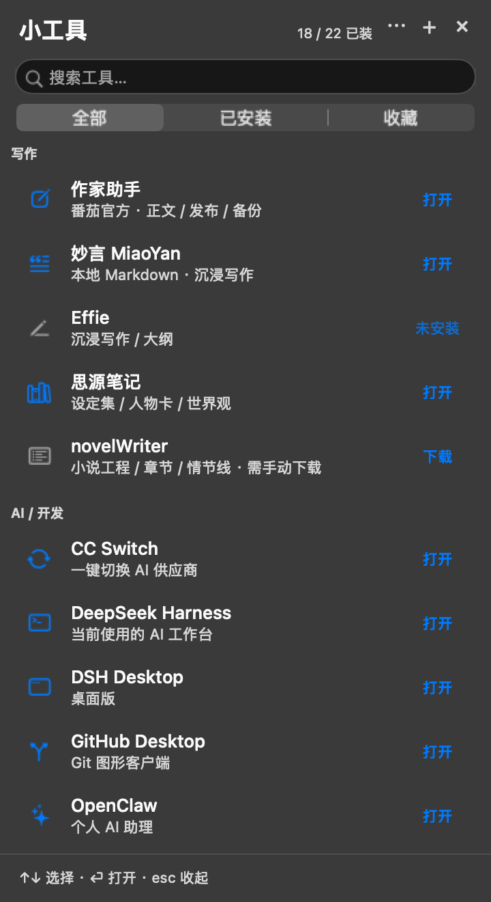

# ToolSidebar

A floating macOS sidebar for writing, AI and system utilities. Press `⌥⌘T`, search and hit Return to open a tool. For tools you have not installed, the built-in installer can find a GitHub release, check the download and install it.

[中文](README.md) · [Download](https://github.com/LOVERS0/tool-sidebar/releases/latest) · [Website](https://lovers0.github.io/tool-sidebar/) · [Issues](https://github.com/LOVERS0/tool-sidebar/issues)



## New in 1.10.0

- All / Installed / Favorites filters. Right-click to favorite a tool; favorites appear first within their category.
- Explicit Open, Install, Update, Get, Visit and Copy actions.
- Search reuses existing rows instead of rebuilding the list after each keystroke.
- Shared installed-app detection across both Applications folders and recorded Bundle IDs.
- Host-aware Intel / Apple Silicon download selection, including Rosetta; Universal packages take priority.
- Staged, validated replacement of installed tools with rollback on commit failure. ToolSidebar itself updates through Sparkle.
- Online translation processes the full text in segments. Editing, changing direction or submitting again cancels the previous request. Failures are clearly labeled as dictionary fallback.

## Install

Requires **macOS 13+**, Apple Silicon or Intel. Download `ToolSidebar.zip` from [Releases](https://github.com/LOVERS0/tool-sidebar/releases/latest), unzip it and move `小工具侧边栏.app` to `/Applications` or `~/Applications`.

The app is ad-hoc signed and **not Apple-notarized**. If macOS blocks the first launch, verify where you downloaded it and follow the instructions in System Settings → Privacy & Security.

```bash
brew tap lovers0/tool-sidebar
brew install --cask tool-sidebar
```

## Use

- `⌥⌘T`: show/hide. The collapsed sidebar becomes a draggable floating ball.
- `⌘F`: search; `↑↓`: select; Return: open or perform the row action; Escape: clear search, then hide.
- Right-click a row to favorite, rename, reorder, categorize, update, uninstall or reveal a cataloged app.
- `+`: add a GitHub repository or search term.
- `⋯`: check for ToolSidebar updates, configure launch at login, batch-install tools, export/import settings and open the translator.

Includes 26 built-in entries plus a remotely refreshed featured list. Manual-download and web entries open the corresponding page. Settings export includes favorites, custom names, order, categories, installed repositories and launch-at-login preference.

## Translation and network requests

The default offline mode only replaces known dictionary terms; it is **not full-text translation**. Online translation is opt-in and sends submitted text to MyMemory. Longer text is segmented, oversized input prompts you to split it, and online failures are labeled as dictionary fallback. Press `⌘↩` to translate.

GitHub requests provide search/release metadata and downloads. A GitHub token can come from `~/.config/tool-sidebar/github_token`, `GITHUB_TOKEN` or an authenticated `gh`; it is only used for GitHub API requests. Direct download failure may fall back to `ghproxy.net`.

## Installation checks

The installer supports `.app` bundles inside DMG or ZIP assets and installs them to `~/Applications`. It does not install PKG packages or CLI-only tools.

When GitHub supplies a SHA-256 digest, it must match. Automatic installation requires both valid code signing and a successful macOS Gatekeeper assessment; failures stop the install and provide the official release page. Quarantine metadata is preserved. ToolSidebar uses Sparkle-signed updates for itself.

## Build and test

Requires macOS and Xcode Command Line Tools.

```bash
git clone https://github.com/LOVERS0/tool-sidebar.git
cd tool-sidebar
./build.sh
./scripts/test.sh
```

Output: `build/小工具侧边栏.app`. The default build does not overwrite an installed copy. `APP_PATH` can select a different absolute `.app` destination; `VERSION`, `SIGN_IDENTITY` and `NOTARY_PROFILE` configure the version, Developer ID signing and notarization.

Regression checks cover architecture selection, failure preservation, subprocess streams, settings compatibility, installed-app resolution, row reuse, filters, translation segmentation and cancellation. Run `./scripts/screenshots.sh` to capture the native views. See [RELEASE.md](RELEASE.md) and [NOTARIZATION.md](NOTARIZATION.md) for distribution.

## License

[MIT](LICENSE)
