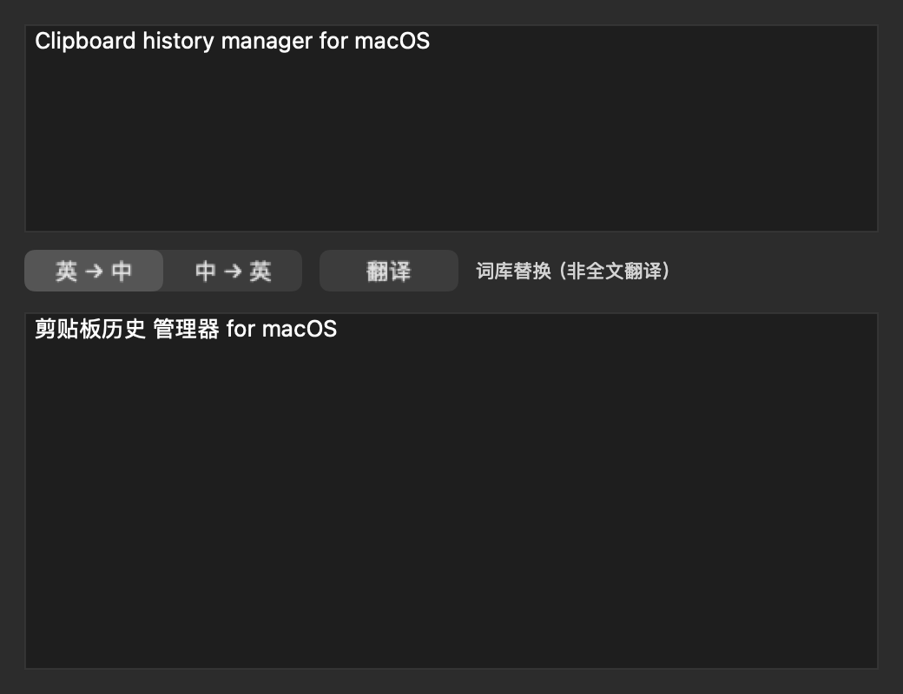

# 小工具侧边栏 · ToolSidebar

[](https://github.com/LOVERS0/tool-sidebar/releases)
[](https://github.com/LOVERS0/tool-sidebar)
[](LICENSE)

[English](README.en.md) · [下载最新版](https://github.com/LOVERS0/tool-sidebar/releases/latest) · [官网](https://lovers0.github.io/tool-sidebar/) · [反馈问题](https://github.com/LOVERS0/tool-sidebar/issues)

把常用的写作、AI 和系统工具放进一个 macOS 悬浮侧边栏。按 `⌥⌘T` 呼出，搜索后回车打开；还没装的工具，可以从 GitHub 下载并安装。


## 1.10.0 更新

- **少翻列表**：新增「全部 / 已安装 / 收藏」筛选。右键收藏工具，收藏项会排在各分类前面。
- **看清再点**：行右侧直接显示「打开、安装、更新、下载、访问、复制」，不再靠圆点猜操作。
- **搜索复用列表行**：输入关键词时只更新显示状态，不再逐字销毁、重建整页列表；保留输入法组词和键盘选中行为。
- **减少安装误判**：识别 `/Applications`、`~/Applications` 中的应用，并使用已记录的 Bundle ID 查找移动或改名后的应用。
- **下载适配芯片**：按 Intel / Apple Silicon 匹配安装包，优先选 Universal 包；Apple Silicon 在 Rosetta 下运行时也能识别。
- **先准备好，再替换**：新版先复制到临时位置并校验，通过后才替换旧版；提交失败时恢复旧版。应用自身更新统一使用 Sparkle 验证签名。
- **翻译不再截掉后半段**：在线翻译自动分段；再次提交、编辑文字或切换方向会取消旧请求。在线失败时明确提示使用词库替换。

## 安装

从 [Releases](https://github.com/LOVERS0/tool-sidebar/releases/latest) 下载 `ToolSidebar.zip`，解压后将 `小工具侧边栏.app` 放入 `/Applications` 或 `~/Applications`。

需要 **macOS 13.0 或更新版本**，支持 Apple Silicon 和 Intel。当前安装包采用 ad-hoc 签名，尚未经过 Apple 公证；如系统拦截首次打开，请先确认下载来源，再按「系统设置 → 隐私与安全」中的提示处理。

也可以通过 Homebrew 安装：

```bash
brew tap lovers0/tool-sidebar
brew install --cask tool-sidebar
```

## 日常使用

| 操作 | 方法 |
| --- | --- |
| 呼出或收起 | `⌥⌘T`；收起后也可点悬浮球展开 |
| 搜索 | `⌘F` 聚焦搜索框，输入名称或说明关键词 |
| 键盘打开 | `↑↓` 选择，`⏎` 打开或执行对应操作 |
| 清空 / 收起 | `Esc` 先清空搜索，再收起侧边栏 |
| 收藏、分类和排序 | 右键工具行 |
| 添加工具 | 顶栏 `+`，输入 `owner/repo`、GitHub 链接或搜索词 |
| 更新、卸载、定位应用 | 右键已收录的工具 |
| 自启、批量安装、迁移 | 顶栏 `⋯` 菜单 |

内置 26 个工具入口，按写作、AI / 开发、系统小工具分组；远程精选列表从仓库的 `featured.json` 更新。手动下载和网页入口会打开对应页面，MarkItDown 入口会复制命令。

你可以重命名工具、调整顺序和分类。换机时，在 `⋯` 中导出配置，再在新机器导入；配置包含已装工具列表、名称、分类、排序、收藏和自启设置。

收起后显示可拖动的悬浮球：


## 中英翻译

在 `⋯` 中打开「中英翻译…」，输入文字后点击翻译或按 `⌘↩`。

默认只用内置词库做词语替换，**不是全文翻译**。需要在线翻译时，在 `⋯` 中显式开启 MyMemory；开启后，提交的文本会发送到该服务。较长文本会分段发送，过长输入会提示拆分；在线服务不可用时会标明回退到了词库。



专业翻译和 OCR 可使用精选入口中的 Easydict 或 Pot。

## 安装与更新的检查

安装助手支持 `.dmg` / `.zip` 中的 `.app`，安装位置为 `~/Applications`；不支持 `.pkg` 安装器和纯命令行工具。

- GitHub 提供官方 SHA-256 digest 时，必须比对一致。
- 自动安装要求代码签名和 macOS Gatekeeper 评估均通过。未通过会停止，并提供官方发布页入口。
- 保留应用隔离标记；不会静默清除系统安全检查。
- 直连下载失败时会尝试 `ghproxy.net` 镜像，仍执行上述检查。计算出的 SHA-256 会写入本地目录记录。
- 应用自身通过 Sparkle 和已签名的 appcast 更新。`⋯` →「检查更新…」可以手动检查。

安装助手会优先读取 `~/.config/tool-sidebar/github_token`，其次读取 `GITHUB_TOKEN`，再尝试已登录的 `gh`，用于提高 GitHub API 配额。Token 仅用于 GitHub API 请求。

## 构建与测试

需要 macOS 和 Xcode Command Line Tools：

```bash
git clone https://github.com/LOVERS0/tool-sidebar.git
cd tool-sidebar
./build.sh
./scripts/test.sh
```

产物位于 `build/小工具侧边栏.app`，默认不会覆盖已安装的版本。可用 `APP_PATH` 指定其他绝对 `.app` 路径；`VERSION`、`SIGN_IDENTITY` 和 `NOTARY_PROFILE` 分别控制版本、Developer ID 签名与公证。

回归检查覆盖芯片架构选择、失败时保留旧版、子进程输出、旧配置兼容、安装识别、搜索行复用、列表筛选、翻译分段与请求取消。CI 会构建 Universal 包并运行检查。

截图来自实际 AppKit 视图，可用 `./scripts/screenshots.sh` 重新生成。发布流程见 [RELEASE.md](RELEASE.md)，Apple 公证配置见 [NOTARIZATION.md](NOTARIZATION.md)。

## 命令行与数据

```bash
APP="/Applications/小工具侧边栏.app/Contents/MacOS/ToolSidebar"
"$APP" --agent search maccy
"$APP" --agent install rxhanson/Rectangle
"$APP" --agent install owner/repo --check-only
"$APP" --agent install owner/repo --force
"$APP" --agent list
"$APP" --agent check-updates
"$APP" --agent remove owner/repo
"$APP" --agent autostart status
"$APP" --agent app-update-check
```

`--check-only` 下载并检查，不安装；`--force` 更新已存在的应用。旧的 `--agent app-update` 直接替换流程已停用，请在应用菜单使用 Sparkle 更新。

| 数据 | 路径 |
| --- | --- |
| 已收录工具 | `~/Library/Application Support/小工具侧边栏/catalog.json` |
| 名称、分类、排序和收藏 | 同目录下的 `overrides.json` |
| 下载缓存 | `~/Library/Caches/ToolSidebar/` |
| 开机自启 | `~/Library/LaunchAgents/com.a1.toolsidebar.plist` |

项目使用 Swift / AppKit，安装助手也是 Swift 实现。界面会按系统语言切换中英文。

## License

[MIT](LICENSE)
