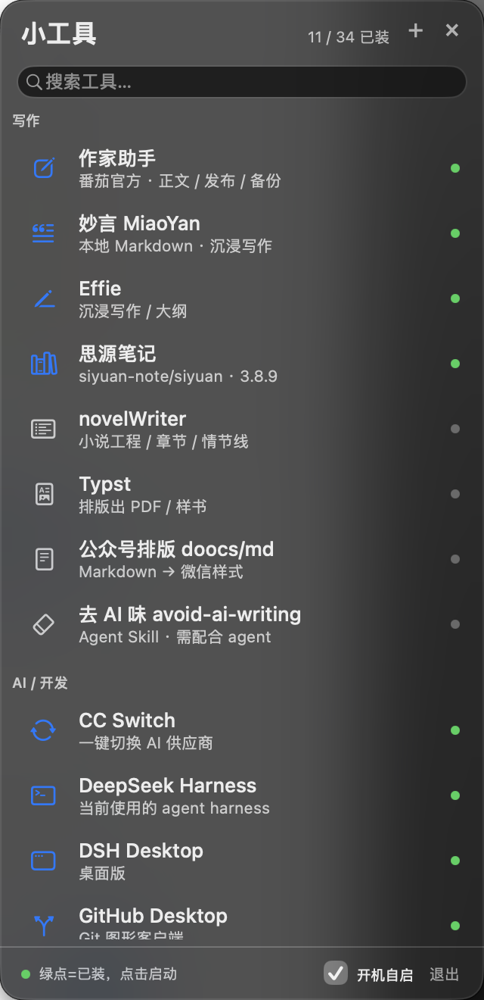
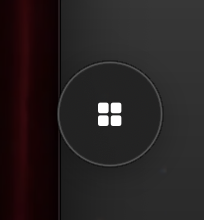
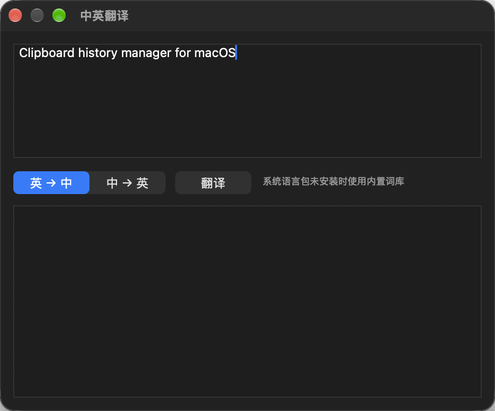

# 小工具侧边栏（ToolSidebar）

> GitHub 仓库：https://github.com/LOVERS0/tool-sidebar  
> 下载：https://github.com/LOVERS0/tool-sidebar/releases

macOS 13+ 的悬浮小工具侧边栏 + 本地安装 agent：把写作 / AI / 系统小工具收进一列，点一下启动；没装的工具，点一下由本地 agent 自动搜索 GitHub → 下载 → 自检 → 安装 → 收录。



收起后是悬浮球（可拖动）：



内置中英翻译（系统语言包未装时用内置词库）：



## 功能

- **一列管所有工具**：内置 26 个（写作 / AI 开发 / 系统小工具），分组、模糊搜索、绿点=已装，点一下启动。
- **本地 agent 全自动安装**：查最新 Release → 选 macOS 包 → 下载 → 自检 → 装到 `~/Applications` → 写入「已收录」，全程不弹浏览器。
- **自检**：
  - 与 GitHub API 提供的官方 `digest`（SHA-256）比对，不一致直接停止；
  - `codesign --verify --deep --strict` 签名校验，不通过不安装；
  - `spctl --assess` 公证 / Gatekeeper 评估，记录 Team ID。
- **更新与卸载**：启动后自动检查已收录工具的版本，有更新会在行里提示；右键菜单可「更新 / 卸载（移到废纸篓）/ 在 Finder 中显示」。
- **Sparkle 官方自动更新**：内嵌 Sparkle 2 + 官方 appcast（`appcast.xml`，EdDSA 签名），菜单里「检查更新…」或自动定时检查。
- **内置中英翻译**：`⋯` → 中英翻译…；优先用系统翻译（macOS 26+ 且装了中英语言包），否则用内置词库离线翻译。
- **远程精选源**：从仓库里的 `featured.json` 拉取「精选」工具，按需收录，不用重新发版。
- **重命名 / 排序 / 分类**：右键任意工具可重命名、上移、下移、移动到默认或自定义分类；分类可新建。
- **批量安装**：`⋯` 菜单里可一键安装所有未安装工具，带进度和失败汇总。
- **换机迁移**：导出/导入配置（已装工具列表 + 重命名/分类/排序 + 开机自启），导入后自动批量安装。
- **开机自启**：底部勾选写入 `~/Library/LaunchAgents`，以 `--silent` 静默启动（不弹窗，只留菜单栏图标）。
- **收起成悬浮球**：关掉侧边栏后变成一个小球，可拖动；点球展开。静默开机启动时也只显示球。
- **全局快捷键 ⌥⌘T**：随时呼出/隐藏侧边栏。
- **打不开的工具**：有现成安装包的自动装；没有的（如 Typst、novelWriter）会提示并可直接打开发布页，不再卡住。
- 菜单栏图标、窗口置顶、`Esc` 隐藏、`⌘Q` 退出。
- **纯 Swift 实现**：agent 也是 Swift，无 Python / 无第三方运行时依赖。

## 兼容性

- macOS 13.0+
- Universal 二进制（Apple Silicon + Intel）
- 未做 Apple 公证（ad-hoc 签名）：首次打开如被 Gatekeeper 拦，右键 → 打开，或执行
  `xattr -dr com.apple.quarantine "$HOME/Applications/小工具侧边栏.app"`

## 安装

```bash
brew tap lovers0/tool-sidebar
brew install --cask tool-sidebar
```

或手动下载：Releases 里的 `ToolSidebar.zip`，解压后把 `小工具侧边栏.app` 放进 `~/Applications`。

## 构建

需要 macOS + Command Line Tools（无需完整 Xcode）：

```bash
cd tool-sidebar
./build.sh
# 产物：~/Applications/小工具侧边栏.app（universal，v1.4.0）
```

## 使用

- 点绿点行：启动对应 App（MarkItDown 行点击复制命令）。
- 点灰点行：本地 agent 自动搜索 / 下载 / 自检 / 安装。
- 顶栏 `+`：输入 `owner/repo`、GitHub 链接或搜索词，任意收录。
- 右键行：更新、卸载、在 Finder 中显示。
- 底部「开机自启」：勾选后下次登录静默启动。

### 命令行 / 自动化

```bash
APP="$HOME/Applications/小工具侧边栏.app/Contents/MacOS/ToolSidebar"

"$APP" --agent search maccy
"$APP" --agent install rxhanson/Rectangle
"$APP" --agent install owner/repo --check-only   # 只下载自检
"$APP" --agent install owner/repo --force        # 覆盖安装 / 更新
"$APP" --agent list
"$APP" --agent check-updates
"$APP" --agent remove owner/repo
"$APP" --agent autostart status|on|off
"$APP" --agent app-update-check         # 检查 App 自身更新
"$APP" --agent app-update               # 下载并解压新版本
```

## 目录与数据

- 已收录目录：`~/Library/Application Support/小工具侧边栏/catalog.json`
- 下载缓存：`~/Library/Caches/ToolSidebar/`
- 开机自启：`~/Library/LaunchAgents/com.a1.toolsidebar.plist`
- 安装位置：`~/Applications`

## 安全说明

- 只安装 `codesign` 校验通过的 `.app`；签名失败立即停止。
- 下载文件的 SHA-256 会写入目录 JSON，便于事后核对；官方提供 digest 时强制比对。
- 直连 GitHub 失败时自动改用 `ghproxy.net` 镜像下载，但仍以官方 digest 校验为准。
- 不自带提权，不静默改系统设置；开机自启用用户级 LaunchAgent。
- 目前支持 `.dmg` / `.zip` 里的 `.app`，不支持 `.pkg` 安装器和纯 CLI 工具（会给出发布页链接）。
- 可选的 GitHub API Token：放在 `~/.config/tool-sidebar/github_token`（提高 API 限额，不会外传）。

## CI

`.github/workflows/build.yml`：push / tag 时自动构建 universal App，tag 时自动创建 Release 附件。

## 目录结构

```
main.swift               # 入口 / CLI 分发
ToolSidebar.swift        # AppKit 界面与交互
Agent.swift              # 本地安装 agent（纯 Swift）
featured.json            # 远程精选源
appcast.xml              # Sparkle 官方更新源（EdDSA 签名）
scripts/fetch-sparkle.sh # 下载 Sparkle 框架
build.sh                 # universal 构建 + 打包
assets/AppIcon.icns      # App 图标
.github/workflows/       # GitHub Actions
```

## License

MIT
